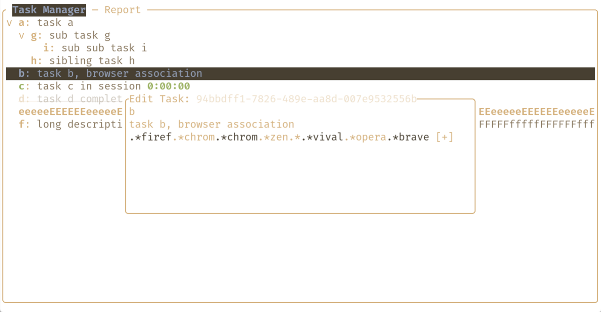
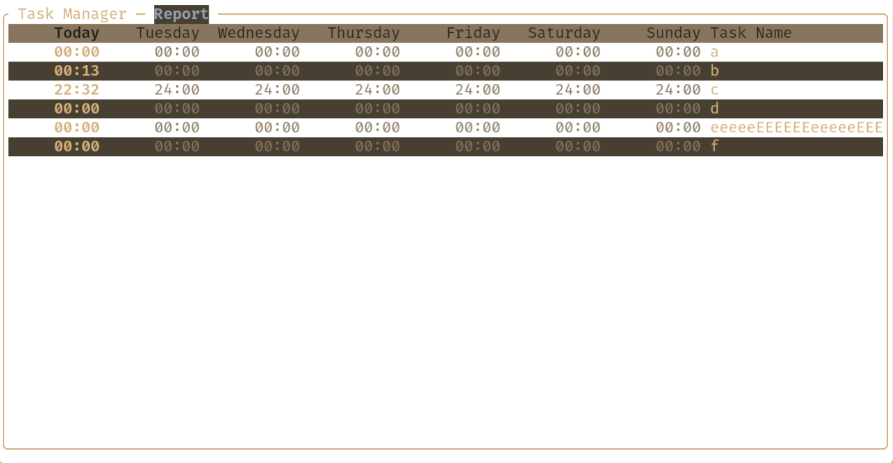

# Dailies
A, tree based, task tracking and management system.

## Features
  - Task tree to manage working tasks
  - Auto tracking system, with window regex matching
    -  Currently only supports plasma on linux (requires `kdotool`)
  - Weekly overview of the time spent on each task

## Preview



## Usage

Simply run the binary with `dailies`
```
A, tree based, task tracking and management system

Usage: dailies [OPTIONS] [COMMAND]

Commands:
  interactive  starts the task manager in interactive mode
  windows      lists all detected open windows
  help         Print this message or the help of the given subcommand(s)

Options:
  -R, --refresh <REFRESH>
          the refresh rate of the application, in milliseconds [default: 1000]
  -r, --report <REPORT>
          the day to generate the report for, in the format YYYY-MM-DD
  -n, --no-auto-track
          disables auto tracking of the tasks
  -g, --grace <GRACE>
          the number of seconds to wait before starting or stopping a task session [default: 5]
  -c, --downtime-interval <DOWNTIME_INTERVAL>
          the downtime length before excluding it from tracking, in minutes [default: 5]
  -d, --dry
          run without saving
  -h, --help
          Print help
  -V, --version
          Print version

Controls:
  arrow keys, tab  navigation
  q                quit
  a                add task
  e                edit task
  d                delete task
  c                complete task
  space            track task
  enter            confirm selection
  esc              cancel selection
```

## Building
Build with: `cargo build --release`

For nixos users a build flake is provided which can be included to your configuration.
```
inputs = {
  dailies.url = "github:Bgabri/dailies-r";
};
...
packages = [
  inputs.dailies.packages."${pkgs.stdenv.hostPlatform.system}".default
];

```
Alternatively it can be ran directly with `nix run github:Bgabri/dailies-r`

## TODO:
Although its mostly useable, it is still missing some desirable features

- [ ] interactive mode
  - [x] list tasks
  - [ ] add/edit task
    - [x] name/ description
    - [ ] goals
  - [ ] move task
  - [x] complete task
  - [x] track task
    - [x] auto track process matching
    - [x] heartbeat
    - [ ] extend support for other os/envs
  - [x] delete task
  - [ ] time spent overview
    - [x] week overview report
  - [ ] local tasks (visible only in given dir)
  - [ ] task info?/analysis (total time, weakly average)
  - [ ] navigation instructions
  - [ ] big timer
  - [ ] gantt chart

- [ ] archiving

- [ ] cli
  - [ ] start with fully open tree
  - [x] tracking debounce
  - [ ] config file?

- [ ] checkstyle
- [ ] docs
- [ ] consistent errors
  - [ ] error handling

